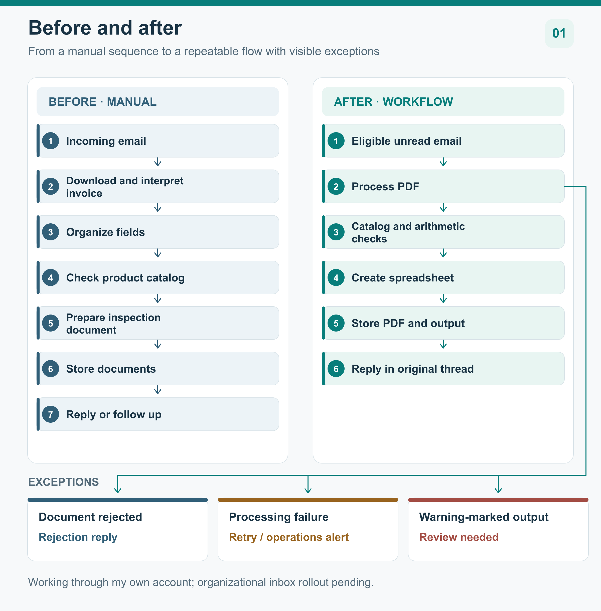
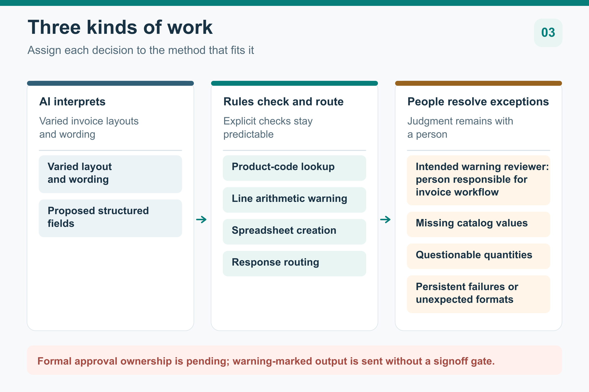
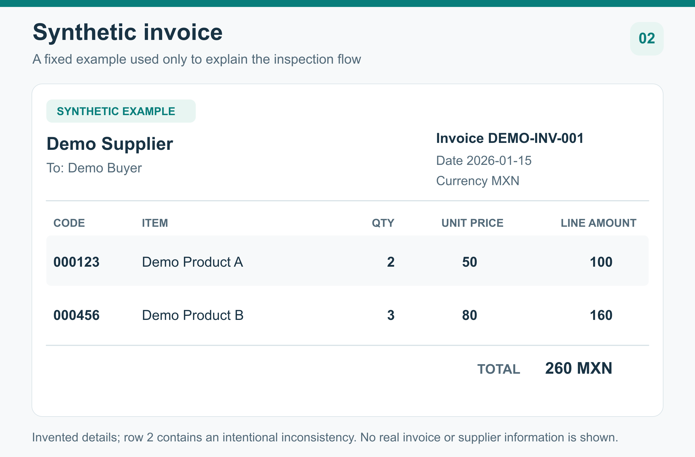
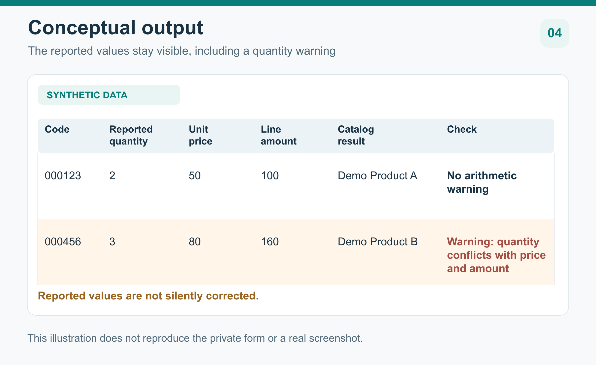
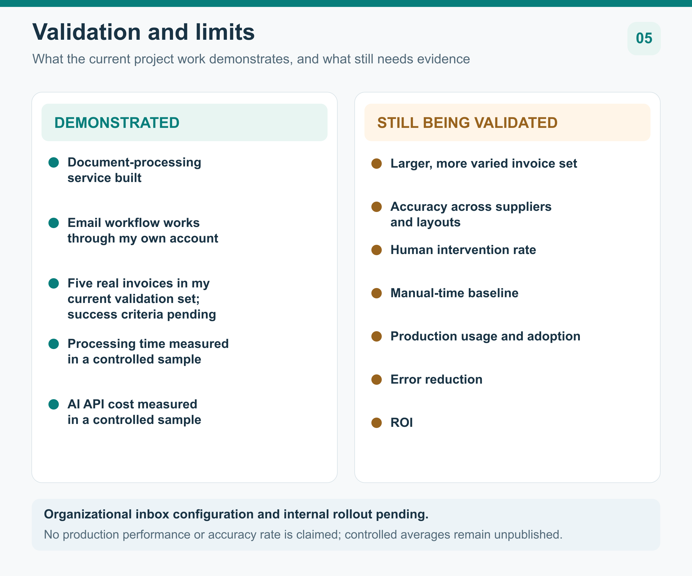

# AI-Assisted Invoice Workflow

[English](README.md) · [Español](README.es-ES.md)

Redesigning a recurring invoice process around interpretation, defined checks, and human review.

**Lucas Perezcano** 
Industrial Engineering | Tecnológico de Monterrey

## The Problem

One employee handled incoming invoices through a fully manual sequence: open the email, download the document, read and organize its information, consult a master product catalog, prepare a standardized inspection spreadsheet, store the documents, and reply or follow up. This was a recurring sequence of decisions across several places, not just a data entry task.

Each invoice required the right document, product information, spreadsheet, and response to stay connected. An unusual layout or questionable quantity needed attention without losing track of the rest of the work. I saw an opportunity to make the routine steps more consistent and exceptions more visible. I have not measured the time or error rate of the original process.

## Before vs. After

**Before:** One employee downloaded and interpreted each invoice, organized its information, looked up products, prepared the inspection document, stored the files, and responded.

**After:** The built workflow reads eligible unread email, sends each PDF for processing, prepares an inspection spreadsheet, stores it alongside the source document, and replies in the original email thread. Documents that cannot be processed follow separate rejection or retry paths. Warnings remain visible for people to review.

## Why I Built It

I observed this workflow myself and identified the opportunity to improve it. Nobody assigned me an AI or automation project. I chose to investigate the process because it was recurring and structured enough that some steps appeared suitable for automation.

It became my first serious AI and workflow-automation project. I learned what I needed to map the task, build the processing and email flow, and test the result. The goal was to handle routine steps consistently while keeping exceptions visible to the person responsible for them.

## My Approach

As an Industrial Engineering student, I approached this as a process-design problem. I mapped how an invoice arrives, what the inspection form needs, what the catalog can confirm, and what should happen when a value is questionable. Then I assigned each step to interpretation, a fixed rule, or a person. **Use AI where interpretation is required. Use deterministic logic where the answer should be predictable. Keep people where judgment matters.**

This matters because an invoice can be readable and still contain a value that deserves scrutiny. A system that fills a spreadsheet without showing uncertainty would make the process look complete too early. The design therefore keeps extracted information, rule checks, and warnings distinct.

## AI vs. Rules vs. Human Judgment

**AI interprets.** Software first extracts text from the PDF. A language model then interprets varied invoice layouts and proposes structured fields, including whether the document is an invoice. Its output is a proposal for subsequent checks, not a final judgment that every value is correct.

**Rules check and route.** Code looks up product codes in a private catalog, compares quantity with unit price and line amount, builds the spreadsheet, and chooses a response path. A failed lookup or arithmetic check produces a warning rather than a silent correction.

**People resolve exceptions.** Missing catalog values, questionable quantities, persistent failures, and unexpected attachment formats need human attention and final resolution. The person responsible for the invoice workflow is the intended reviewer of warnings. Formal approval ownership and signoff are still to be defined; the current workflow stores and replies with a warning-marked spreadsheet without waiting for approval.

## The Solution

The workflow connects a document-processing service to an email process. For an eligible message, it reads the attached PDF, prepares structured invoice information, checks the values that have explicit rules, and creates an inspection spreadsheet. It then files the original PDF and spreadsheet together and replies in the same thread with links.

A document rejection receives a reply. A processing failure leaves the message available for retry and alerts operations when a response is received. These paths make the result and the need for follow-up visible.

The example invoice and spreadsheet shown here use invented names, codes, and amounts. They illustrate the flow and a quantity warning without exposing a real invoice or catalog.

  

## High-Level Architecture

A processing service reads PDF text, asks a language model for structured fields, applies catalog and arithmetic checks, and prepares the spreadsheet. A separate email workflow selects eligible messages, calls that service, stores the source and output, and routes replies or alerts according to the result.

### Further Reading

For a deeper look at the implementation and its limitations:

**English**

- [System Architecture](docs/english/architecture.md)
- [Design Decisions](docs/english/design-decisions.md)
- [Validation and Current Status](docs/english/validation.md)

**Español**

- [Arquitectura del sistema](docs/spanish/architecture.md)
- [Decisiones de diseño](docs/spanish/design-decisions.md)
- [Validación y estado actual](docs/spanish/validation.md)

## Validation

**Demonstrated today.** The document-processing service and email workflow are built, and the email flow works through my own account. **Five real invoices are in my current validation set; their outcome criteria are being documented.** Mocked and smoke tests cover selected request and routing paths. Controlled tests have also measured processing time and AI API cost per invoice, but the sample size and measurement boundaries are still being confirmed. These are project validation results, not production results.

**Still being validated.** I am gathering more real invoices and outputs. The current set does not establish accuracy across suppliers or layouts, the rate of human intervention, error reduction, or time saved against a measured manual baseline. Internal notes describe repeated field comparisons with four distinct invoice examples, but the references, per-run outputs, and discrepancy definitions are unavailable for this case study. There is no basis yet for a published accuracy percentage, production throughput, adoption claim, or ROI.

## Current Status

The processing service and email workflow work through my own account. Organizational inbox configuration and internal rollout are the remaining steps before official use.

## What I Built / My Contribution

I built the document-processing service and the email workflow around it. That work includes turning invoice text into structured fields, checking product codes and line arithmetic, preparing the inspection spreadsheet, and routing documents and responses according to the result.

My main contribution was connecting those parts to the original business task. The workflow has to preserve the relationship between an incoming document, its output, and the reply, while making failures and warnings understandable to the person responsible for the process.

## What I Learned

The useful starting point for automation is a clear account of the work and its exceptions. Once I could describe those, the choice between interpretation, fixed rules, and human review became easier.

I also learned that producing an output is only part of operational readiness. The person responsible for the invoice workflow is the intended reviewer of warnings, while formal approval ownership, retries, and safe use of the result still need to be defined for rollout. In the current design, warning-marked output is sent before signoff.

## Technical Overview

The system uses a Python document-processing service, PDF text extraction, a language model for interpretation, deterministic catalog and arithmetic checks, spreadsheet generation, and an email workflow for filing and replies.

## Privacy / Confidentiality

All invoice details and product data shown in this public case study are synthetic. Real invoices, supplier and company information, the private catalog, and the operational implementation remain private. The public examples explain the workflow; they are not copies of company documents or a claim that the illustrated spreadsheet matches the private form exactly.
