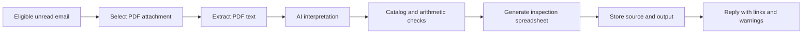

# System Architecture

## Overview

The workflow has two parts. A document-processing service turns an invoice PDF into a proposed set of fields, checks values that have explicit rules, and generates an inspection spreadsheet. A separate email workflow selects eligible messages, sends PDF attachments to the service, stores the source and output, and replies in the original thread. The public diagram describes responsibilities and information flow, not deployment details.

## Processing Flow

An email run selects unread messages with attachments and identifies PDF attachments. For each recognized PDF, the service extracts available text from the document. A language model interprets that text, decides whether it represents an invoice, and proposes structured invoice and line-item fields. The model's output is input to later checks; it is not a verified transcription of the source.

Application logic looks up extracted item codes in a private product catalog and compares extracted quantity, unit price, and line amount. A missing catalog match or questionable arithmetic is marked for review. The logic does not silently replace a reported value. It creates an inspection spreadsheet from the proposed fields and lookup results.

For a processed invoice, the email workflow stores the spreadsheet with the original PDF and replies in the source thread with links and any warnings. Keeping the source, output, and response connected makes it easier for the person handling the invoice to find the material behind a result. This is a description of the implemented path, not a claim that every organizational control is in place.

## Component Responsibilities

**AI interpretation** handles variation in invoice layouts and wording and proposes the document classification and fields. **Deterministic logic** performs catalog lookup, arithmetic checks, spreadsheet generation, and routing by processing result. **Email orchestration** selects messages, passes PDFs to the service, files documents, and sends replies or alerts. **People** remain responsible for resolving warnings, missing information, unusual attachments, and persistent failures. The intended warning reviewer is the person responsible for the invoice workflow; formal approval ownership is not yet defined.

## Exception Handling

A **document rejection** means no spreadsheet is generated; the workflow replies with the reason and treats that attachment as handled. This path includes documents judged not to be invoices and PDFs with too little extractable text. A **processing failure** takes a different path: a non-rejection service response triggers an operations alert and leaves the message unread for a later run. A message with no recognized PDF also remains unread for manual attention. An unexpected exception leaves the message unread, but the current exception handler does not send the same operations alert.

A **validation warning** is neither a rejection nor a processing failure. The spreadsheet is still stored and sent with the warning. There is no enforced human approval gate before that reply. A **successful service response** means an output was generated; subsequent storage and reply actions must also complete for the email path to finish. Neither event certifies that every extracted field is correct or that the output was approved for use.
