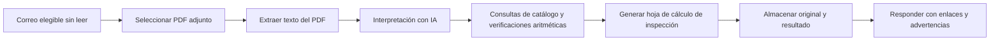

# Arquitectura del sistema

## Descripción general

El flujo de trabajo tiene dos partes. Un servicio de procesamiento de documentos convierte un PDF de factura en un conjunto propuesto de campos, verifica los valores para los que existen reglas explícitas y genera una hoja de cálculo de inspección. Un flujo de correo independiente selecciona los mensajes elegibles, envía los PDF adjuntos al servicio, almacena el documento original y el resultado, y responde en el hilo original. El diagrama público describe responsabilidades y flujo de información, no detalles de despliegue.

## Flujo de procesamiento

En cada ejecución, el flujo de correo selecciona mensajes sin leer que tienen archivos adjuntos e identifica los PDF. Para cada PDF reconocido, el servicio extrae el texto disponible. Un modelo de lenguaje interpreta ese texto, decide si corresponde a una factura y propone campos estructurados de la factura y sus partidas. La respuesta del modelo alimenta las verificaciones posteriores; no es una transcripción comprobada contra el documento original.

La lógica de la aplicación consulta los códigos de artículo extraídos en un catálogo privado de productos y compara la cantidad, el precio unitario y el importe de cada partida. Si no encuentra un código en el catálogo o detecta una discrepancia aritmética, marca el caso para revisión. La lógica no sustituye silenciosamente un valor reportado. Con los campos propuestos y los resultados de las consultas genera la hoja de cálculo de inspección.

Para una factura procesada, el flujo de correo almacena la hoja de cálculo junto con el PDF original y responde en el mismo hilo con enlaces y las advertencias correspondientes. Mantener relacionados el documento original, el resultado y la respuesta facilita que la persona responsable encuentre la información detrás de cada resultado. Esta es una descripción de la ruta implementada, no una afirmación de que todos los controles organizacionales ya estén establecidos.

## Responsabilidades de los componentes

La **interpretación con IA** atiende la variación en los formatos y la redacción de las facturas, y propone la clasificación del documento y sus campos. La **lógica determinística** realiza las consultas de catálogo, las verificaciones aritméticas, la generación de la hoja de cálculo y el enrutamiento según el resultado del procesamiento. La **orquestación del correo** selecciona mensajes, entrega los PDF al servicio, archiva los documentos y envía respuestas o alertas. Las **personas** siguen siendo responsables de resolver advertencias, información faltante, archivos adjuntos inusuales y fallas persistentes. La persona encargada del flujo de facturas es quien se prevé que revise las advertencias; la responsabilidad formal de aprobación aún no está definida.

## Manejo de excepciones

Un **rechazo del documento** significa que no se genera una hoja de cálculo; el flujo responde con el motivo y considera atendido ese archivo adjunto. Esta ruta incluye documentos clasificados como ajenos a una factura y PDF con muy poco texto extraíble. Una **falla de procesamiento** sigue otra ruta: una respuesta de error del servicio que no sea un rechazo genera una alerta para operaciones y deja el mensaje sin leer para una ejecución posterior. Un mensaje sin PDF reconocido también permanece sin leer para revisión manual. Una excepción inesperada deja el mensaje sin leer, pero el manejador actual de excepciones no envía esa misma alerta a operaciones.

Una **advertencia de validación** no equivale a un rechazo ni a una falla de procesamiento. La hoja de cálculo se almacena y se envía con la advertencia. No hay un paso obligatorio de aprobación humana antes de esa respuesta. Una **respuesta exitosa del servicio** significa que se generó un resultado; para que concluya la ruta del correo también deben completarse el almacenamiento y la respuesta. Ninguno de esos eventos certifica que todos los campos extraídos sean correctos ni que el resultado haya sido aprobado para su uso.
